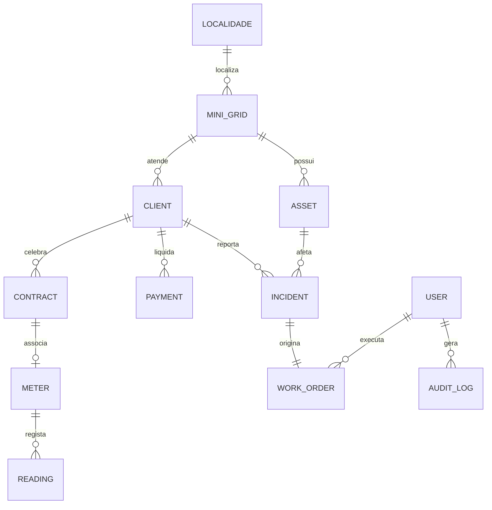

# LECASU GridOps — Relatório de Descoberta e Análise de Requisitos (Etapa 01)

**Documento:** Relatório de Descoberta de Produto (Discovery Report)  
**Código do Documento:** `docs/01-DISCOVERY-REPORT.md`  
**Referência Principal:** `docs/PRD.md` (Nota Conceptual e Especificação Funcional v1.0)  
**Regras de Governação:** `AGENTS.md`  
**Entidade Promotora:** LECASU, Lda.  
**Data:** 05 de Novembro de 2026  
**Estado:** Submetido para Validação e Aprovação Formal  

---

## 1. Introdução e Enquadramento Geral

O presente relatório consolida a análise detalhada e exaustiva da Nota Conceptual e Especificação Funcional do **LECASU GridOps** (`docs/PRD.md`), em estrito cumprimento com as normas de desenvolvimento por etapas estabelecidas no documento `AGENTS.md`.

O **LECASU GridOps** surge como uma resposta estratégica aos desafios operacionais, comerciais e de sustentabilidade associados à eletrificação rural em Moçambique. Historicamente, a gestão de mini-redes isoladas tem sido fragmentada por ficheiros em folha de cálculo isoladas, comunicações informais, aplicações heterogéneas de fabricantes de equipamentos e arquivos físicos em papel. Este cenário dificulta a reconciliação financeira, atrasa a resposta a avarias técnicas e compromete a transparência perante reguladores (ARENE), entidades públicas (FUNAE) e parceiros de desenvolvimento.

O GridOps posiciona-se como uma **plataforma integrada e centralizada**, funcionando como a **camada de inteligência e gestão do negócio** da LECASU.

> **Princípio Fundamental de Delimitação do Produto:**  
> Conforme estabelecido expressamente no PRD (Seção 1.3 e Decisão de Produto), o LECASU GridOps **não substitui** sistemas de controlo industrial, proteções elétricas, EMS (Energy Management System) ou SCADA de campo. A plataforma é uma ferramenta de governação, operação, comercialização, gestão de ativos e cálculo de impacto, integrando telemetria técnica de inversores e contadores inteligentes através de adaptadores e interfaces documentadas.

---

## 2. Visão do Produto e Objetivos Estratégicos

### 2.1 Visão
Disponibilizar uma plataforma digital acessível por navegador web e dispositivo móvel, preparada para operar de forma fiável em contextos de conectividade móvel limitada (offline-first), proporcionando uma visão unificada e auditável de cada mini-rede, cliente, contrato, contador, pagamento, ativo patrimonial e ocorrência técnica.

### 2.2 Objetivos Gerais e Específicos
* **Objetivo Geral:** Centralizar o ciclo de vida completo de mini-redes fotovoltaicas com armazenamento em baterias (BESS), articulando a componente técnica de engenharia com a gestão comercial, financeira e de impacto comunitário.
* **Objetivos Específicos do MVP:**
  1. **Cadastro e Georreferenciação (GIS):** Mapear perímetro de serviço, linhas de distribuição em MT/BT, postes, caixas de derivação, centrais fotovoltaicas e localização exata de cada cliente rural.
  2. **Cadastro Comercial Único:** Eliminar cadastros duplicados através de um identificador estruturado e unificado para pessoas, microempresas, unidades sanitárias e escolas.
  3. **Medição, Faturação e Cobrança:** Acompanhar o ciclo de leitura (manual, ficheiro em lote ou telemetria IoT), aplicação tarifária homologada, registo de pagamentos e apuramento em tempo real de saldos e dívidas.
  4. **Operação & Manutenção (O&M):** Estruturar o fluxo de assistência técnica com abertura de ordens de trabalho (OT), despacho a técnicos de campo, evidências fotográficas de resolução e cálculo de indicadores de fiabilidade (MTTR, SLA).
  5. **Métricas de Impacto e Governação:** Apurar indicadores sociais (população coberta, mulheres e jovens beneficiados, apoio a Usos Produtivos de Energia - PUE) e ambientais (energia limpa gerada e emissões de CO₂ evitadas).
  6. **Rastreabilidade e Segurança:** Implementar controlo de acesso estrito baseado em papéis (RBAC) e uma trilha de auditoria inviolável que documente utilizador, timestamp, dados anteriores e novos para qualquer operação relevante.

### 2.3 Princípios de Conceção Fundamentais
* **Fonte Única de Informação:** Dados consolidados numa única base de dados relacional que preserva integridade referencial.
* **Operação Offline-First:** Agentes comunitários e técnicos de terreno recolhem dados, fotos e coordenadas GPS sem cobertura de rede, sincronizando os registos automaticamente assim que detetam ligação GSM/Wi-Fi.
* **Independência de Hardware:** Arquitetura desacoplada de fabricantes específicos de inversores (Huawei, SMA, Victron, Deye) ou marcas de contadores inteligentes (Hexing, Inhemeter, Landis+Gyr).
* **Simplicidade e Inclusão:** Interfaces projetadas para facilidade de utilização, respeitando diferentes níveis de literacia digital dos operadores comunitários.

---

## 3. Estrutura Funcional e Mapeamento dos 8 Módulos do PRD

A Seção 4 do PRD define a arquitetura funcional da plataforma, desdobrada em 8 módulos integrados:

```
+----------------------------------------------------------------------------------------------------+
|                                      LECASU GRIDOPS — PLATAFORMA                                   |
+----------------------------------------------------------------------------------------------------+
|  [4.1 Mini-Redes & GIS]      [4.2 Clientes & Contratos]       [4.3 Contadores & Consumo]           |
|  • Código & Localização GPS  • Pessoas, Negócios & PUE        • Inventário STS / IoT               |
|  • Capacidade Solar & BESS   • Potência, Tarifa & Caução      • Leituras & Alertas de Fraude       |
|  • Perímetro & Rede MT/BT    • Vínculo Mini-Rede/Contador     • Histórico de Consumo               |
+----------------------------------------------------------------------------------------------------+
|  [4.4 Tarifas & Pagamentos]  [4.5 Gestão de Activos]          [4.6 Operação & Manutenção]          |
|  • Escalões & Regras ARENE   • Centrais, Inversores, BESS     • Incidentes & Avarias               |
|  • Pré/Pós-Pago & Dívidas    • Série, Garantia & Custos       • OTs, Fotos & Evidências            |
|  • M-Pesa / e-Mola / mKesh   • Fichas Técnicas & Manuais      • Planos Preventivos & MTTR          |
+----------------------------------------------------------------------------------------------------+
|  [4.7 Indicadores & Reporte]                                  [4.8 Comunicação & Atendimento]      |
|  • Painel Executivo por Mini-Rede                             • Notificações SMS / WhatsApp        |
|  • Relatórios ARENE / FUNAE / Parceiros                       • Histórico na Ficha do Cliente      |
|  • Exportação estruturada Excel / PDF                         • Alertas de Corte & Religação       |
+----------------------------------------------------------------------------------------------------+
```

### 3.1 Módulo 1: Cadastro de Mini-redes e GIS (PRD 4.1)
* **Funcionalidades:**
  * Registo cadastral: Código da central, designação, província, distrito, localidade e ponto GPS da central.
  * Caracterização energética: Potência solar fotovoltaica (kWp), capacidade nominal do banco de baterias BESS (kWh), potência de conversão dos inversores (kVA) e data de comissionamento operacional.
  * Visualização cartográfica (GIS): Mapa espacial interativo exibindo perímetro da concessão, traçado das redes de distribuição de média/baixa tensão, ativos georreferenciados e clientes conectados.
  * Gestão de estados operacionais: `planeada`, `em instalação`, `activa`, `parcialmente indisponível` ou `suspensa`.
  * Repositório documental: Associação de esquemas unifilares, licenças ambientais e de concessão, fotos da central e contactos locais das lideranças comunitárias.

### 3.2 Módulo 2: Gestão de Clientes e Contratos (PRD 4.2)
* **Funcionalidades:**
  * Cadastro unificado de entidades: Pessoa individual, entidade comercial/negócio ou instituição pública (escolas, centros de saúde, postos administrativos).
  * Classificação setorial: Residencial, Comercial, Institucional, Telecomunicações, Serviço Público e Usos Produtivos de Energia (PUE — moageiras, carpintarias, bombas de água, sistemas de frio).
  * Registo contratual: Potência contratada (kVA), modelo tarifário aprovado, valor de caução em custódia e data de ativação do fornecimento.
  * Histórico de eventos do contrato: Alterações de titularidade, transferências de ponto, suspensões temporárias e encerramentos.
  * Vinculação física: Associação unívoca do cliente à mini-rede correta, respetivo circuito/ramal elétrico, fase de distribuição e número de série do contador instalado.

### 3.3 Módulo 3: Contadores, Leituras e Consumo (PRD 4.3)
* **Funcionalidades:**
  * Inventário técnico de contadores: Número de série inviolável, tecnologia (STS Pré-pago, Eletromecânico/Eletrónico Pós-pago, Inteligente IoT), estado operacional e coordenadas geográficas.
  * Ingestão de leituras: Registo manual por agente de campo via aplicação móvel, importação em lote via ficheiros estruturados (CSV/Excel) e preparação para recepção automática via API/gateway de telemetria.
  * Análise de consumo: Agregação periódica de kWh por cliente, categoria tarifária, ramal e mini-rede consolidada.
  * Motor de alertas operacionais: Deteção de ausência prolongada de leitura, consumos anómalos (picos ou quedas bruscas) e suspeita de perda não técnica ou fraude/by-pass.
  * Histórico do medidor: Registos de calibragem, intervenções metrológicas, avarias e ordens de substituição.

### 3.4 Módulo 4: Tarifas, Facturação e Pagamentos (PRD 4.4)
* **Funcionalidades:**
  * Parametrização tarifária: Configuração de tarifas homologadas pelo regulador, taxas fixas de disponibilidade e estruturas de escalões de consumo.
  * Modalidades comerciais: Suporte a regime Pré-pagamento (venda de tokens STS), Pós-pagamento faturado e modelos híbridos.
  * Gestão de transações financeiras: Registo de pagamentos com referência de transação, emissão de recibos, suporte a reversões justificadas e reconciliação financeira.
  * Posição financeira do cliente: Saldo pré-pago remanescente, faturação emitida, histórico de pagamentos, dívidas vencidas e controlo de notificações.
  * Integração de canais de pagamento: Estrutura preparada para integração gradual com carteiras digitais de Moçambique (M-Pesa, e-Mola, mKesh) e depósitos bancários.

### 3.5 Módulo 5: Gestão de Activos (PRD 4.5)
* **Funcionalidades:**
  * Árvore hierárquica de património: Central geradora -> Inversores de rede/ilhas -> Banco de baterias BESS -> Quadros de comando e proteção -> Transformadores -> Cabos de rede -> Postes de iluminação/distribuição.
  * Atributos técnicos: Código patrimonial, fabricante, modelo, número de série, data de entrada em serviço, garantia de fábrica e localização precisa.
  * Ciclo de vida e manutenção: Histórico completo de vistorias, manutenções preventivas, reparações efetuadas, peças substituídas e custos acumulados.
  * Fichas técnicas e manuais: Armazenamento associado de catálogos dos equipamentos, procedimentos de segurança e garantias.

### 3.6 Módulo 6: Operação e Manutenção — O&M (PRD 4.6)
* **Funcionalidades:**
  * Gestão de ocorrências e avarias: Registo de incidentes, pedidos de assistência, reclamações de clientes e alertas gerados por telemetria.
  * Triagem e priorização: Classificação de gravidade, impacto no fornecimento de energia, atribuição de técnico de campo e estabelecimento de prazo limite (SLA).
  * Ordem de Trabalho (OT): Diagnóstico de avaria, lista de atividades realizadas, materiais/peças consumidas, registo fotográfico do antes e depois e recolha de assinatura do cliente ou líder local.
  * Indicadores de fiabilidade: Cálculo automatizado do tempo de resposta, Tempo Médio de Reparação (MTTR), tempo de indisponibilidade acumulada e identificação de causas raiz reincidentes.
  * Manutenção preventiva calendarizada: Criação e acompanhamento de planos periódicos por ativo e por localidade (ex: limpeza de painéis, reaperto de bornes elétricos, testes de baterias).

### 3.7 Módulo 7: Indicadores e Relatórios (PRD 4.7)
* **Funcionalidades:**
  * Painéis analíticos dinâmicos: Visão por mini-rede individual, agrupamento regional/provincial e consolidação da carteira total.
  * Dimensões de análise: Indicadores técnicos (geração, perdas, disponibilidade), comerciais (clientes ativos, taxa de cobrança), financeiros (receita, dívida), sociais (famílias, escolas, unidades sanitárias e PUE) e ambientais (redução de diesel e tCO₂ evitado).
  * Perfis de visualização e exportação: Formatação específica para relatórios de gestão executiva interna, auditorias oficiais do FUNAE, conformidade com o regulador ARENE e prestação de contas a doadores internacionais.
  * Mecanismo de exportação: Geração de relatórios em formatos abertos (Excel/CSV) e documentos protegidos para leitura (PDF), com filtros por data e controlo de versões.

### 3.8 Módulo 8: Comunicação e Atendimento (PRD 4.8)
* **Funcionalidades:**
  * Centralização de contactos: Registo de pedidos de informação, solicitações de ligação e reclamações de serviço associados à ficha de cada cliente.
  * Notificações automáticas: Emissão de avisos de confirmação de pagamento, alertas de saldo baixo, notificações de corte por dívida, avisos prévios de interrupção para manutenção e confirmação de fecho de ocorrências.
  * Canais de envio: Suporte a SMS, correio eletrónico e mensagens por WhatsApp, operando mediante gateways locais autorizados.

---

## 4. Perfis de Utilizador e Matriz de Acessos (RBAC)

De acordo com o PRD (Seção 2 e Anexo A), a governação e segurança da plataforma assentam no princípio do menor privilégio, distribuído por 8 perfis:

| Perfil (`role`) | Responsabilidades Principais | Nível de Acesso no Sistema |
| :--- | :--- | :--- |
| **Administrador Geral** | Gestão de utilizadores, parametrização global, perfis RBAC, auditoria de segurança e configurações do sistema. | **Acesso Integral (Full Access)** em todos os módulos e tabelas. |
| **Gestor de Operações (O&M)** | Monitorização da frota de mini-redes, desempenho de ativos, triagem e despacho de incidentes, aprovação de OTs e relatórios técnicos. | Leitura/Escrita em Mini-redes, Activos, Ocorrências e Ordens de Trabalho. Leitura em GIS e Indicadores Técnicos. |
| **Gestor Comercial** | Ciclo de clientes, celebração de contratos, definição de estruturas tarifárias, gestão de contadores e cobrança de dívidas. | Leitura/Escrita em Clientes, Contratos, Tarifas, Contadores e Faturação. Leitura de relatórios comerciais. |
| **Técnico de Campo** | Execução de ordens de serviço no terreno, vistorias técnicas, instalação de contadores, leitura manual e registo de avarias com fotos. | Acesso móvel offline-first; Leitura nas OTs atribuídas; Escrita em Leituras, Checklist de OTs e Evidências fotográficas. |
| **Agente Comunitário** | Apoio de proximidade nas aldeias, recolha inicial de cadastro com GPS, apoio no atendimento a dúvidas e sensibilização local. | Acesso móvel; Criação de pré-cadastros de clientes e registo de leituras da sua localidade de afetação. |
| **Gestor Financeiro** | Reconciliação bancária e de carteiras móveis (M-Pesa/e-Mola), validação de receitas, gestão de cauções e relatórios fiscais. | Leitura/Escrita em Pagamentos, Reconciliações e Dívidas. Acesso aos relatórios financeiros. |
| **Parceiro ou Auditor (FUNAE / ARENE)** | Fiscalização regulatória, auditoria de dados operacionais, verificação de metas de eletrificação e conformidade de tarifas. | **Acesso Estritamente de Leitura (Read-Only)** a painéis executivos, relatórios de impacto e evidências autorizadas. |
| **Cliente Rural** *(Fase Futura)* | Consulta individual de histórico de consumo, saldo pré-pago, verificação de faturas e envio de reclamações de fornecimento. | Acesso restrito via portal ou aplicação do cliente, visualizando unicamente a sua própria conta contratual. |

---

## 5. Análise dos Processos Operacionais Prioritários (PRD Seção 7)

O PRD mapeia 5 fluxos operacionais críticos que definem a dinâmica de negócio da LECASU:


### Análise dos Pontos Críticos dos Processos:
* **Transição de Estados no Fluxo de Nova Ligação:** Exige sincronização entre a aprovação contratual e a disponibilização de contador físico no inventário. O cliente não pode passar a `activo` sem validação de coordenadas GPS válidas.
* **Validação de Leituras:** O sistema deve verificar leituras anómalas (leitura atual inferior à anterior, ou superior a 300% da média histórica) antes de consolidar a faturação.
* **Encerramento de OTs:** O fecho técnico pelo eletricista só é considerado completo após anexação de pelo menos uma fotografia comprobatória e registo de causa raiz.

---

## 6. Modelo de Entidades e Relações de Base de Dados (PRD Seção 6)

A integridade do modelo de dados do LECASU GridOps assenta em relações rígidas que refletem a infraestrutura física e o relacionamento comercial:



### Entidades Essenciais e Campos Obrigatórios (Definidos no PRD):
1. **`mini_grids`**: Código unívoco (`MR-XXX-NNN`), nome, localização, província, distrito, localidade, coordenadas geográficas (latitude/longitude), capacidade fotovoltaica (kWp), armazenamento BESS (kWh), potência de conversão, estado operacional e operador local.
2. **`clients`**: Código único (`MR001-RES-0001` ou `MR001-PUE-0001`), nome completo, documento de identificação, telefone/contacto, coordenadas GPS, fotografia da residência/estabelecimento, categoria tarifária, estado e consentimento de dados.
3. **`contracts`**: Número sequencial, cliente_id, tarifa_id, potência contratada (kVA), caução retida, data de celebração, data de ativação, estado do contrato e documentos anexados.
4. **`meters`**: Número de série de fábrica, tipo tecnológico (STS pré-pago, inteligente, monofásico/trifásico), protocolo de comunicação, estado operacional, cliente_id, data de instalação e carimbo da última comunicação.
5. **`readings`**: Contador_id, data/hora da leitura, energia acumulada (kWh), fonte da leitura (manual/importação/IoT), índice de qualidade e utilizador/sistema de origem.
6. **`payments`**: Referência da transação, cliente_id, valor liquidado (MZN), data/hora, canal (M-Pesa, e-Mola, mKesh, depósito bancário, numerário), estado de reconciliação e código de recibo emitido.
7. **`assets`**: Código patrimonial (`AST-XXX`), classe hierárquica, fabricante, modelo, número de série, data de instalação, garantia, localização GPS e estado operacional.
8. **`incidents`**: Código da ocorrência, tipo (avaria, fraude, interrupção, manutenção), prioridade (baixa, média, alta, crítica), descrição detalhada, vínculo a cliente ou ativo, datas e estado do fluxo.
9. **`work_orders`**: Número de ordem (`OT-AAAA-NNNNNN`), incidente_id, técnico atribuído, atividades realizadas, catálogo de materiais aplicados, evidências fotográficas, assinatura e aprovação de encerramento.
10. **`audit_logs`**: Utilizador_id, tabela afetada, registo afetado, tipo de ação (INSERT, UPDATE, DELETE), dados antes da alteração, dados posteriores, timestamp e endereço IP de origem.

> **Regra de Governação de Dados (PRD Seção 6):**  
> É estritamente vedada a eliminação física (`DELETE` físico) de registos operacionais, contratos, transações financeiras ou ordens de trabalho. O modelo deve aplicar exclusão lógica (`soft-delete`) e controlo cronológico de versões para preservar conformidade em auditorias regulatórias.

---

## 7. Requisitos Funcionais e Não Funcionais

### 7.1 Requisitos Funcionais Prioritários do MVP (PRD Seção 12 e Anexo A)
* **RF-01 (Mapa da Carteira):** Visualizar num mapa cartográfico interativo todas as mini-redes da carteira, permitindo filtros por província e estado operacional (História US-01).
* **RF-02 (Cadastro Móvel e GPS):** Registar clientes no terreno com coordenadas de satélite e fotografia do local mesmo na ausência de sinal de internet (História US-02).
* **RF-03 (Associação Comercial):** Criar contrato de fornecimento e vincular o contador e ramal elétrico ao cliente recém-cadastrado (História US-03).
* **RF-04 (Gestão de Leituras):** Registar leituras de medidores com validação instantânea de consumo e preservação do histórico de kWh (História US-04).
* **RF-05 (Registo e Reconciliação Financeira):** Registar transações de pagamento móvel ou em numerário, calcular saldo pré-pago ou abater dívidas pendentes e reconciliar lançamentos (História US-05).
* **RF-06 (Fluxo Completo de O&M):** Receber avaria técnica, gerar Ordem de Trabalho, anexar registo fotográfico e fechar com parecer técnico (História US-06).
* **RF-07 (Relatórios e Exportações):** Consolidar indicadores de geração, clientes, faturação e impacto em relatórios estruturados e exportáveis em Excel e PDF (História US-07).
* **RF-08 (Auditoria Imutável):** Registar automaticamente qualquer criação ou alteração em registos sensíveis numa trilha cronológica imutável.

### 7.2 Requisitos Não Funcionais (PRD Seção 10 e 11)
* **RNF-01 (Disponibilidade e Resiliência):** Acesso contínuo com arquitetura estável, cópias de segurança (backups) automáticas e procedimento documentado de restauração de desastre.
* **RNF-02 (Desempenho em Ambientes Rurais):** Carregamento rápido e tráfego de dados otimizado para ligações móveis lentas (redes 2G/3G nas zonas remotas).
* **RNF-03 (Operação Offline-First):** As interfaces de campo devem manter formulários e recolha de coordenadas disponíveis em cache local (IndexedDB/PWA), permitindo trabalho em zonas de sombra e posterior sincronização automática.
* **RNF-04 (Segurança e Autenticação):** Autenticação robusta stateless via tokens JWT assinados, controlo de acesso baseado em papéis (RBAC) validado em todas as camadas, e proteção contra SQL Injection e ataques de Cross-Site Scripting (XSS).
* **RNF-05 (Auditabilidade e Conformidade Legal):** Histórico de auditoria inviolável, proteção e privacidade dos dados dos beneficiários rurais em conformidade com o quadro legal moçambicano.
* **RNF-06 (Responsividade e Usabilidade):** Layout adaptável a ecrãs de computadores desktop, tablets e smartphones de gama de entrada usados pelas equipas operacionais.

---

## 8. Critérios de Aceitação do MVP (PRD Seção 12.1)

Para que a versão MVP seja aprovada para entrada em fase piloto numa mini-rede da LECASU, devem ser cumpridos com sucesso os seguintes 8 critérios:

1. **Critério 1 — Mini-rede no Mapa:** Cadastrar com sucesso uma nova mini-rede e visualizá-la no mapa cartográfico com indicadores de capacidade e coordenadas geográficas corretas.
2. **Critério 2 — Cadastro e Ficha do Cliente:** Cadastrar um cliente, associá-lo ao respetivo contrato, contador e ramal, e consultar a sua ficha completa com dados georreferenciados e fotografia.
3. **Critério 3 — Leituras e Histórico:** Registar leituras de energia manuais e verificar o cálculo correto de consumo histórico por período.
4. **Critério 4 — Pagamento e Saldo:** Registar transação de pagamento e verificar a atualização imediata da posição financeira do cliente (saldo pré-pago ou regularização de dívida).
5. **Critério 5 — Ciclo de Ordem de Trabalho:** Abrir uma ocorrência técnica, emitir a respetiva ordem de trabalho, anexar fotografias comprobatórias e efetuar o encerramento com sucesso.
6. **Critério 6 — Relatórios e Exportação:** Gerar relatório executivo e técnico filtrado por mini-rede e descarregar o ficheiro em formato Excel ou PDF.
7. **Critério 7 — Controlo de Permissões e Auditoria:** Demonstrar que utilizadores com perfis distintos possuem permissões adequadas (ex: Auditor apenas visualiza dados) e verificar que cada operação gerou o respetivo registo imutável de auditoria.
8. **Critério 8 — Backup e Restauro:** Executar o procedimento de cópia de segurança e demonstrar a restauração controlada da base de dados do sistema.

---

## 9. Dependências, Riscos Identificados e Questões Pendentes para a LECASU

A análise rigorosa do PRD permitiu identificar dependências críticas do ambiente operacional, potenciais riscos de execução e áreas onde é necessária decisão prévia da gestão da LECASU.

### 9.1 Dependências Externas
* **Ecossistema de Carteiras Móveis (M-Pesa / e-Mola / mKesh):** A viabilidade da reconciliação automática depende da contratação e concessão de credenciais das APIs empresariais (C2B/B2C) com as operadoras de telecomunicações locais (Vodacom, Movitel, Tmcel).
* **Protocolos e Fornecedores de Medição:** A leitura automática futura depende do protocolo dos contadores inteligentes adquiridos pela LECASU (DLMS/COSEM, STS IEC 62055 ou formatos proprietários).
* **Cartografia e Satélite:** Dependência de conectividade para carregamento de camadas cartográficas base (ex: OpenStreetMap / Google Maps) e precisão do GPS dos equipamentos móveis dos técnicos em terrenos com vegetação densa.

### 9.2 Matriz de Riscos Operacionais e Medidas de Controlo

| Risco Identificado | Impacto Operacional | Medida de Mitigação Proposta |
| :--- | :--- | :--- |
| **1. Conectividade Rural Instável** | Impossibilidade de sincronização em tempo real de cadastros e leituras. | Arquitetura PWA Offline-First estrita com armazenamento local temporário (IndexedDB) e fila de sincronização com resolução de conflitos por timestamp. |
| **2. Falta de Documentação Civil Formal dos Clientes** | Clientes rurais sem BI ou NUIT formal, impossibilitando cadastro tradicional. | Criação de campo alternativo para "Declaração de Residência / Validação do Líder Comunitário", garantindo que nenhum beneficiário é excluído. |
| **3. Diversidade de Marcas de Inversores e Baterias** | Interfaces de monitorização proprietárias e incompatíveis entre centrais solares. | Foco no MVP como camada de agregação de KPIs manuais/ficheiros, estruturando adaptadores modulares para futuras integrações de telemetria. |
| **4. Fraude e Perdas Não Técnicas** | Ligação direta à rede sem passar pelo medidor (by-pass). | Algoritmo de deteção de balanço de energia na baixa tensão (comparação da energia total injetada na saída do transformador com a soma dos contadores dos clientes). |

### 9.3 Questões e Decisões Pendentes (Aguardando Esclarecimento da LECASU)

Para assegurar que o desenvolvimento posterior não assenta em suposições, apresentam-se as seguintes questões de negócio para validação formal:

1. **Validação de Identificação de Clientes:**  
   *Nas zonas rurais mais isoladas onde alguns chefes de família não possuem Bilhete de Identidade ou NUIT, deve o sistema admitir o registo com base no testemunho do Agente Comunitário ou número de Cartão de Eleitor/declaração local?*
2. **Regras de Estrutura Tarifária Homologada:**  
   *Como deve o sistema estruturar o cálculo tarifário? Aplica-se uma tarifa única por kWh com taxa fixa mensal de disponibilidade, ou existe uma tarifa social subsidiada em escalões (ex: bloco até 30 kWh a preço social e consumo excedente a preço pleno)?*
3. **Política de Corte por Dívida:**  
   *Nos contratos em regime pós-pago, qual é o período de tolerância regulamentar antes de o sistema gerar automaticamente uma notificação de corte e respetiva ordem de serviço de desligação (ex: 15 dias após o vencimento)?*
4. **Governação de Estornos e Reversões:**  
   *Em caso de erro no registo de pagamento móvel ou numerário, a anulação/reversão de um recibo exige aprovação dupla (ex: Administrador e Gestor Financeiro) ou pode ser executada diretamente com justificação de auditoria?*
5. **Fabricantes de Medidores para o Piloto:**  
   *Quais são as marcas e modelos específicos de contadores já adquiridos ou selecionados para a primeira mini-rede piloto da LECASU (ex: Hexing, Inhemeter, Landis+Gyr)?*

---

## 10. Quadro Comparativo: Requisitos do PRD vs. Recomendações Técnicas

Para assegurar transparência absoluta e respeitar a regra fundamental de que *"O PRD prevalece sobre suposições do agente"*, apresenta-se a separação formal entre o que está mandatado pelo PRD e as recomendações técnicas da equipa de engenharia:

| Elemento / Domínio | O que está Estritamente Definido no PRD | Recomendações Técnicas Propostas |
| :--- | :--- | :--- |
| **Camada de Controlo SCADA/EMS** | O GridOps **não substitui** o controlo industrial de inversores nem o despacho de baterias (PRD 1.3). | Manter painel com foco em indicadores executivos (kW, kWh, SoC%, Uptime) sem acionamento remoto de interruptores de potência. |
| **Modo de Operação de Campo** | Suporte a funcionamento offline nas tarefas de campo com sincronização posterior (PRD 1.4 e 10). | Utilização de Progressive Web App (PWA) nativo com `Service Worker` e `IndexedDB` local para guardar formulários antes da submissão. |
| **Base de Dados e Dados Cartográficos** | Georreferenciação de centrais, rede, ativos e clientes com preservação de históricos sem eliminação física (PRD 6). | Adoção de **PostgreSQL** com a extensão **PostGIS**, permitindo consultas espaciais nativas (cálculo de distâncias, raios de cobertura e exportação GeoJSON). |
| **Integração de Pagamentos Móveis** | Suporte a pré e pós-pagamento com integração gradual de M-Pesa, e-Mola e mKesh (PRD 4.4 e 9). | No MVP implementar o registo transacional robusto e conciliação manual por referência, preparando endpoints Webhook padronizados para quando as APIs forem contratadas. |
| **Segurança e Acesso** | Controlo de acesso por papéis (RBAC), tokens de sessão e registo de auditoria imutável (PRD 2 e 11). | Utilização de JSON Web Tokens (JWT) seguros assinados com claims de perfil (`role`), com expiração controlada e middleware de validação estrito em cada endpoint. |
| **Arquitetura de Software** | Solução modular, leve, acessível por navegador web e preparada para uso móvel (PRD 3.1). | Arquitetura desacoplada: **Frontend Vanilla** modular e leve (sem overhead de frameworks pesadas para garantir rapidez em dispositivos modestos) e **Backend RESTful** organizado em camadas (Rotas, Controladores, Lógica de Negócio, Modelos). |

---

## 11. Conclusão e Próximos Passos

O **LECASU GridOps** possui uma definição de produto clara, focada em resolver os estrangulamentos operacionais reais da eletrificação rural em Moçambique. O escopo do MVP é realista e auto-contido, permitindo comprovar o valor da plataforma antes de assumir dependências contratuais complexas de integração externa.

Este relatório conclui a **Etapa 01 — Descoberta e Análise de Requisitos**.

### Ações Imediatas:
1. Submissão deste documento para revisão e apreciação da equipa da LECASU.
2. Esclarecimento das 5 decisões de negócio pendentes enumeradas na Seção 9.3.
3. Aguardar aprovação formal e explícita para avançar para a **Etapa 02 — Arquitetura e Engenharia de Software**.

