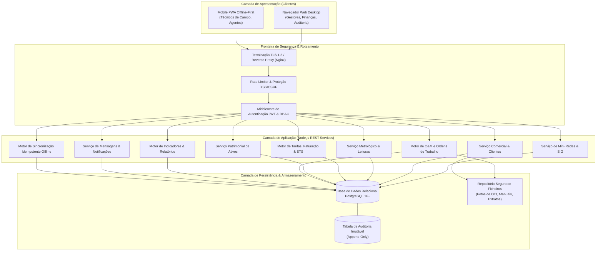

# 07 — Documento de Arquitectura de Software
## LECASU GridOps — Plataforma Integrada de Gestão de Mini-Redes de Energia

**Documento:** Arquitectura Técnica Global e Desenho Estrutural de Sistemas  
**Projeto:** LECASU GridOps  
**Organização Promotora:** LECASU, Lda.  
**Referências Centrais:** PRD Consolidada (`docs/02-PRD-CONSOLIDADA.md`), Catálogo de Requisitos (`docs/03-CATALOGO-DE-REQUISITOS.md`) e Diretrizes de Governação (`AGENTS.md`)  
**Responsável:** Arquitecto de Software Sénior e Engenharia de Sistemas  
**Data de Emissão:** 05 de Novembro de 2026  
**Estado:** Submetido para Validação e Aprovação Formal  

---

## 1. Visão Geral da Arquitectura

A plataforma **LECASU GridOps** adota uma arquitectura em camadas desacopladas (*Decoupled Layered Architecture*), orientada a serviços modulares e com suporte nativo a clientes híbridos (*Web Desktop* e *PWA Offline-First*).

O sistema divide-se em quatro camadas essenciais:
1. **Camada de Apresentação (Frontend / PWA):** Aplicação Single Page Application (SPA) construída com tecnologias web padrão (HTML5, Vanilla CSS3 corporativo e Vanilla JavaScript ES6+), empacotada com Service Workers e IndexedDB para permitir a operação em campo 100% offline.
2. **Camada de Gateway e Roteamento (API Gateway / Middleware):** Ponto de entrada RESTful sobre HTTPS (TLS 1.3), responsável por terminação de sessão, autenticação por tokens JWT, validação de esquemas (JSON Schema), controlo de taxa (*Rate Limiting*) e autorização granular por perfil (RBAC).
3. **Camada de Lógica de Negócio e Serviços (Backend Core):** Conjunto modular de serviços em Node.js organizados pelo padrão *Controller-Service-Repository*, isolando domínios como Faturação, Geração STS, Gestão de Ordens de Trabalho e Balanço Metrológico.
4. **Camada de Dados e Persistência (Storage Layer):** Base de dados relacional robusta em **PostgreSQL**, com índices geoespaciais (PostGIS) para o módulo SIG, histórico imutável para auditoria e armazenamento de ficheiros/evidências fotográficas no sistema de ficheiros local/armazenamento de objetos com metadados relacionais.

---

## 2. Arquitectura Frontend (PWA & Desktop)

### 2.1 Princípios de Desenho
* **Zero Framework Bloat:** A interface é desenvolvida com base em Vanilla JavaScript estruturado de forma modular (componentes com renderização determinística baseada no estado global `AppState`), eliminando dependências pesadas de frameworks (React/Angular/Vue) que aumentam o consumo de memória e diminuem a performance em smartphones de baixo custo utilizados no meio rural moçambicano.
* **Componentes Reutilizáveis:** Estrutura baseada em mini-componentes modulares (Cartões KPI, Modais de Ação, Tabelas com paginação e filtros dinâmicos, Marcadores de Mapa e Medidores Circulares).
* **Gestão de Estado Reativa:** Um padrão *Store / Observer* centralizado que gere: Token de Autenticação, Dados do Utilizador Ativo, Fila de Sincronização Offline e Notificações de Topo.
* **Cartografia Integrada (Leaflet GIS):** Biblioteca leve de mapas vetoriais e satélite sem custos de licença, consumindo camadas OpenStreetMap e imagens de satélite abertas com cache local de azulejos (*tiles*) pré-carregados para a zona da concessão.

### 2.2 Estratégia do Progressive Web App (PWA)
* **Manifesto da Aplicação (`manifest.json`):** Permite a instalação direta no ecrã principal de tablets e telemóveis Android/iOS como se fosse uma aplicação nativa.
* **Service Worker Inteligente:**
  - *Cache-First para Recursos Estáticos:* CSS, fontes Inter, ícones SVG e lógica JS são servidos imediatamente do cache local do navegador, garantindo carregamento instantâneo mesmo com sinal GSM desligado.
  - *Network-First com Fallback Offline para APIs de Leitura:* Consultas a cadastros tentam o servidor; se falhar, recorrem à base local IndexedDB.
  - *Fila de Submissões Pendentes (Outbox Queue):* Registo de leituras, fecho de OTs e recibos em numerário são gravados em IndexedDB e disparados assim que o evento `online` é detetado pelo navegador.

---

## 3. Arquitectura Backend

### 3.1 Padrão Estrutural (Controller-Service-Repository)
O backend organiza-se segundo uma separação estrita de responsabilidades:
1. **Controllers (Controladores HTTP):** Recebem as requisições, validam parâmetros sintáticos de entrada, invocam o serviço correspondente e formatam a resposta HTTP padronizada em JSON.
2. **Services (Camada de Lógica de Negócio):** Implementam as regras de negócio puras (cálculo de escalões tarifários, deduções de dívidas, validação de rotação de contador, geração de tokens STS, regras de SLA de OTs). Não acedem diretamente a comandos SQL de infraestrutura.
3. **Repositories / Data Access (Camada de Dados):** Executam comandos SQL parametrizados na base de dados PostgreSQL através de um pool de conexões otimizado (`pg.Pool`), gerindo transações (`BEGIN / COMMIT / ROLLBACK`) para garantir atomicidade em operações financeiras e de stock.

### 3.2 Estrutura e Formato das Respostas de API
Todas as respostas da API seguem um formato previsível e padronizado:
* **Sucesso:**
  `{ "success": true, "data": { ... }, "meta": { "timestamp": "...", "page": 1 } }`
* **Erro:**
  `{ "success": false, "error": { "code": "INVALID_METER_NUMBER", "message": "O contador informado não está ativo." } }`

---

## 4. Gestão de Ficheiros e Evidências

1. **Tipos de Ficheiros Suportados:**
   * Evidências fotográficas de intervenções de campo (JPEG/PNG comprimidas a $< 500\text{ KB}$ no cliente antes do envio).
   * Documentos de identificação de clientes (BI/NUIT ou Atestado de Residência).
   * Manuais técnicos e fichas de ativos em formato PDF.
   * Extratos bancários e ficheiros de exportação em formato CSV/Excel.
2. **Armazenamento Seguro:**
   * Os ficheiros são armazenados no diretório seguro de armazenamento do servidor (`storage/uploads/`), organizados por concessão e entidade (ex: `storage/uploads/ots/{ot_id}/evidencias/`).
   * No PostgreSQL são armazenados apenas os metadados do ficheiro (UUID, nome original, caminho relativo no disco, MIME type, tamanho em bytes e hash SHA-256 de integridade).
   * O acesso a ficheiros privados é intermediado pela API com verificação obrigatória de permissão de sessão.

---

## 5. Sistema de Notificações e Mensagens

* **Arquitetura Desacoplada por Filas:** O envio de SMS e alertas nunca bloqueia a resposta da API HTTP. A API grava o evento na tabela `notifications_queue` e um processo de background (*Worker*) processa a fila de forma assíncrona.
* **Provedores de SMS em Moçambique:** Abstração de integração com gateways de telecomunicações locais (Vodacom, Movitel, Tmcel) ou provedores agregadores (ex: BulkSMS, Infobip, Twilio) com failover configurável.
* **Políticas de Retentativa:** Até 3 tentativas com *exponential backoff* em caso de falha de operadora.

---

## 6. Avaliação e Justificação das Tecnologias Selecionadas

| Componente | Tecnologia Escolhida | Justificação Técnica e de Negócio | Alternativas Rejeitadas & Motivo |
| :--- | :--- | :--- | :--- |
| **Linguagem Backend** | **Node.js (LTS)** | Elevado desempenho em operações I/O concorrentes, baixo consumo de memória, ecossistema maduro e ampla disponibilidade de técnicos em Moçambique. | Python/Django (maior consumo de RAM para alta concorrência); Java/Spring (complexidade de setup e overhead de memória). |
| **Framework HTTP** | **Express.js** | Minimalista, estável, sem convenções rígidas desnecessárias e total controlo sobre middlewares de segurança e rotas. | NestJS (camadas excessivas de abstração para o escopo do MVP). |
| **Base de Dados Principal**| **PostgreSQL 16+** | Padrão da indústria para integridade relacional ACID, suporte nativo a JSONB para payloads de auditoria, e extensão PostGIS para georreferenciação de redes. | MySQL (capacidades geoespaciais e suporte a JSON inferiores); MongoDB (inadequado para transações financeiras e relacionamentos complexos). |
| **Frontend** | **Vanilla JS (ES6+) PWA** | Zero tempo de compilação em runtime, carregamento imediato, consumo mínimo de bateria em smartphones Android rurais, sem quebras por dependências depreciadas. | React/Next.js (bundle pesado, hidratação lenta em redes 2G/3G e complexidade de manutenção offline). |
| **Cartografia SIG** | **Leaflet GIS** | Biblioteca aberta, leve (apenas ~40 KB), suporta camadas offline pré-carregadas e marcadores interativos com excelente desempenho móvel. | Google Maps API (custos elevados por chamada e dependência de conexão contínua). |
| **Segurança / Auth** | **JWT + bcrypt** | Autenticação stateless ideal para ambientes com conexões intermitentes, com assinaturas HMAC-SHA256 e senhas com hashing de alto custo. | Sessões baseadas em cookies de servidor (dificuldade de manutenção em clientes móveis offline). |
