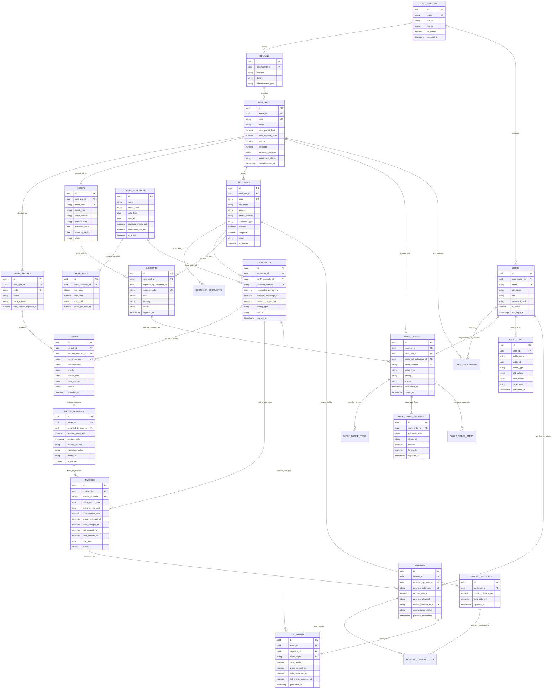

# 08 — Modelo Entidade-Relacionamento (ERD)
## LECASU GridOps — Plataforma Integrada de Gestão de Mini-Redes de Energia

**Documento:** Desenho do Modelo Conceitual e Lógico de Base de Dados  
**Projeto:** LECASU GridOps  
**Organização Promotora:** LECASU, Lda.  
**Referências Centrais:** PRD Consolidada (`docs/02-PRD-CONSOLIDADA.md`), Regras de Negócio (`docs/05-REGRAS-DE-NEGOCIO.md`) e Arquitectura de Software (`docs/07-ARQUITECTURA-DE-SOFTWARE.md`)  
**Responsável:** Modelação de Dados e Arquitectura de Base de Dados  
**Data de Emissão:** 05 de Novembro de 2026  
**Estado:** Submetido para Validação e Aprovação Formal  

---

## 1. Visão Geral da Modelação

O modelo de dados do **LECASU GridOps** foi projetado para assegurar estrita integridade referencial, rastreabilidade completa e suporte multi-concessão.

A estrutura nuclear obedece à hierarquia operacional mandatória:
$$\text{Organizações} \longrightarrow \text{Regiões} \longrightarrow \text{Mini-Redes} \longrightarrow \text{Circuitos} \longrightarrow \text{Clientes} \longrightarrow \text{Contratos} \longrightarrow \text{Contadores} \longrightarrow \text{Leituras} \longrightarrow \text{Faturação} \longrightarrow \text{Pagamentos}$$

Em paralelo, articulam-se os submódulos de **Gestão Patrimonial de Ativos**, **Ocorrências & Ordens de Trabalho (O&M)**, **Governação de Utilizadores (RBAC)** e **Trilha de Auditoria Imutável**.

---

## 2. Diagrama Entidade-Relacionamento Completo (Mermaid ERD)

---

## 3. Descrição das Principais Relações e Integridade

1. **Organização $\rightarrow$ Regiões $\rightarrow$ Mini-Redes:**
   * Uma Organização possui múltiplas Regiões geográficas; cada Região agrega uma ou mais Mini-Redes solares.
   * Não é permitida a existência de uma Mini-Rede órfã sem vinculação geográfica e organizacional.
2. **Mini-Rede $\rightarrow$ Circuitos $\rightarrow$ Contadores:**
   * Cada Mini-Rede divide-se em circuitos elétricos de distribuição. Cada contador metrológico está eletricamente conectado a um circuito específico para apuramento de balanços energéticos setoriais.
3. **Cliente $\rightarrow$ Contrato $\rightarrow$ Contador:**
   * A relação entre Cliente e Contador é sempre intermediada pelo **Contrato**.
   * Um contrato possui exatamente um contador ativo no momento. Ao substituir um contador danificado, o contador antigo tem o vínculo encerrado com carimbo temporal e o novo contador é associado mantendo o número do contrato.
4. **Leituras $\rightarrow$ Faturação / Vending STS:**
   * Em regime pós-pago, a leitura validada alimenta o cálculo da Fatura.
   * Em regime pré-pago, o pagamento direto dispara a geração de registo na entidade `STS_TOKENS`, que registra de forma auditável os 20 dígitos gerados e o rateio financeiro (energia vs amortização de dívida).
5. **Auditoria Geral Imutável (`AUDIT_LOGS`):**
   * Tabela em modo *append-only*. Não admite comandos `UPDATE` ou `DELETE`. Todas as mutações em clientes, contratos, faturas, pagamentos e utilizadores disparam triggers relacionais que inserem uma nova linha nesta tabela com o payload anterior e atual.
