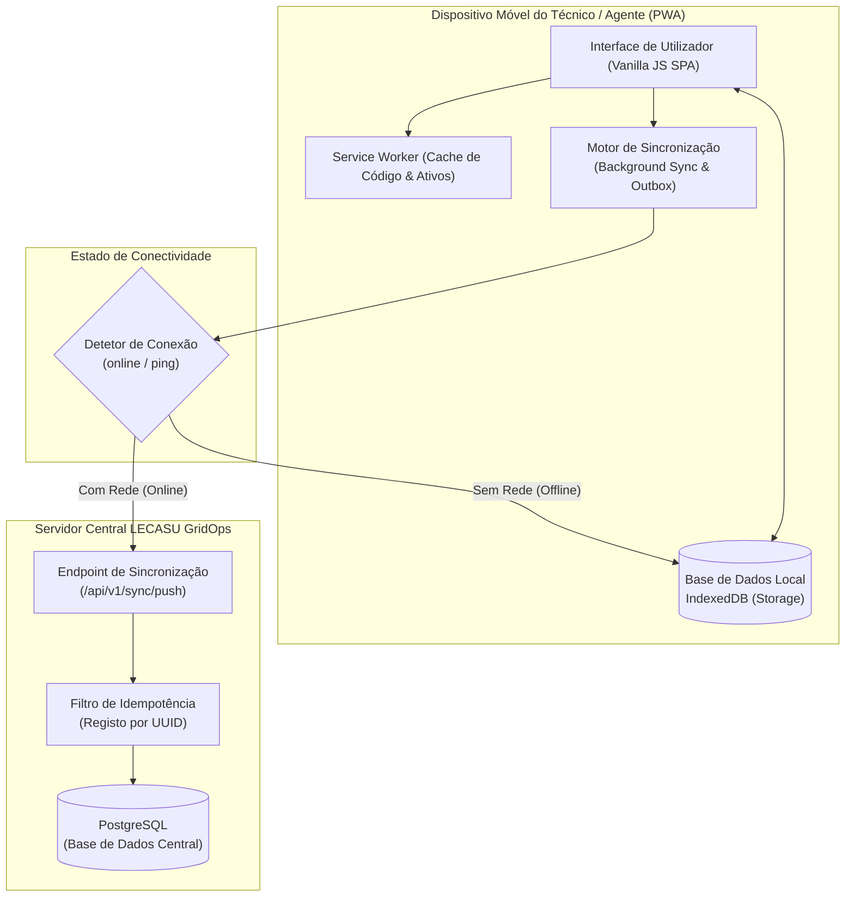

# 12 — Estratégia de Funcionamento Offline e Sincronização
## LECASU GridOps — Plataforma Integrada de Gestão de Mini-Redes de Energia

**Documento:** Especificação Técnica de Arquitectura Offline-First e Protocolo de Sincronização  
**Projeto:** LECASU GridOps  
**Organização Promotora:** LECASU, Lda.  
**Referências Centrais:** PRD Consolidada (`docs/02-PRD-CONSOLIDADA.md`), Catálogo de Requisitos (`docs/03-CATALOGO-DE-REQUISITOS.md`) e Especificação de APIs (`docs/10-ESPECIFICACAO-DE-APIS.md`)  
**Responsável:** Arquitectura de Sistemas Móveis e Engenharia Offline-First  
**Data de Emissão:** 05 de Novembro de 2026  
**Estado:** Submetido para Validação e Aprovação Formal  

---

## 1. Desafio Operacional em Moçambique

As mini-redes solares fotovoltaicas da **LECASU** operam frequentemente em comunidades rurais isoladas onde a cobertura de telecomunicações móveis (2G/3G/4G) é fraca, instável ou totalmente inexistente (*zonas de sombra*).

O técnico de campo e o agente comunitário não podem depender de conectividade contínua para desempenhar as suas funções nucleares:
* Ler contadores ao longo das rotas de povoações dispersas.
* Executar vistorias e fechar Ordens de Trabalho (OTs) de corte, religação ou reparação de rede.
* Registar candidaturas de novos clientes e recolher fotografias de documentos.
* Consultar cadastros técnicos de contadores e circuitos elétricos.

Portanto, o LECASU GridOps foi concebido com uma arquitetura estritamente **Offline-First**: a aplicação móvel funciona primariamente sobre a sua base de dados local no dispositivo, considerando a ligação à Internet como uma oportunidade de sincronização diferida.

---

## 2. Arquitetura da Solução Offline (PWA)

### 2.1 Componentes Técnicos no Cliente
1. **Service Worker Corporativo:**
   - Pré-armazena em cache estático todos os ficheiros da aplicação (HTML, CSS3, ficheiros JavaScript, ícones SVG e fontes).
   - Interceta todas as requisições HTTP do navegador. Quando offline, responde instantaneamente a partir do cache local, garantindo que a aplicação abre em menos de 1 segundo mesmo com modo de avião ativo.
2. **IndexedDB (Base de Dados Local no Navegador):**
   - Base de dados estruturada no telemóvel com capacidade de armazenamento de até 1 GB (dependente do hardware do telemóvel), sem limites rígidos de cookies ou `localStorage`.
   - Lojas de objetos (*Object Stores*) estruturadas:
     * `offline_meters`: Contadores da mini-rede com número de série, cliente associado e última leitura conhecida.
     * `offline_work_orders`: OTs abertas e atribuídas ao técnico para a jornada de trabalho.
     * `offline_customers`: Lista de clientes locais para consulta e verificação de dados.
     * `offline_outbox_queue`: Fila de eventos pendentes de submissão ao servidor central.

---

## 3. Fluxo de Trabalho Offline e Fila de Submissões (*Outbox Queue*)

### 3.1 Criação de Registos em Modo Desconectado
1. O técnico abre a aplicação no terreno sem rede GSM.
2. Efetua a leitura de um contador ou o fecho de uma OT:
   - A interface gera no próprio telemóvel um **UUID v4** único universal (ex: `e3b0c442-98fc-4c14-9afe-4678b8764012`).
   - A fotografia do mostrador ou evidência da intervenção é capturada via câmara do telemóvel e redimensionada/comprimida no navegador para formato JPEG (máximo 1280x720px, qualidade 75%, tamanho $< 350\text{ KB}$).
   - O registo é gravado imediatamente no IndexedDB na loja `offline_outbox_queue` com o carimbo temporal UTC local (`captured_at`) e coordenadas de GPS obtidas do sensor do smartphone.
3. A interface apresenta o registo como "Concluído localmente" com um ícone de nuvem amarela com indicador de pendência (ex: *12 leituras pendentes de envio*).

---

## 4. Protocolo de Sincronização Bidirecional

### 4.1 Gatilhos de Disparo da Sincronização
A sincronização é ativada automaticamente quando qualquer uma das seguintes condições for verificada:
* O navegador emite o evento `online` do sistema operativo.
* A cada 5 minutos, a aplicação executa um teste leve de ping (`HEAD /api/v1/health`) com timeout de 3 segundos para confirmar que a rede possui tráfego real (evitando falsos positivos de portais cativos).
* O utilizador clica voluntariamente no botão "Sincronizar Agora" na barra superior da interface.

### 4.2 Protocolo de Envio (*Push Synchronization*)
1. A aplicação recolhe todos os eventos ordenados cronologicamente na `offline_outbox_queue`.
2. Empacota os eventos num lote JSON e envia via `POST /api/v1/sync/push`.
3. O servidor recebe o pacote e processa cada evento dentro de uma transação isolada de base de dados:
   - **Garantia de Idempotência:** O servidor verifica se o `event_uuid` já existe na tabela `processed_sync_events`. Se já existir (devido a uma retransmissão por queda de sinal após receção), o servidor responde com sucesso sem duplicar a ação na base de dados.
   - Aplica as regras de negócio correspondentes (validação de leitura, cálculo de saldo, fecho de OT).
4. O servidor devolve a lista de confirmações (`{ event_uuid: "...", status: "APPLIED" }`).
5. A aplicação remove os itens confirmados da `offline_outbox_queue` e atualiza o estado visual no ecrã para verde ("Todos os dados sincronizados").

### 4.3 Protocolo de Receção (*Pull Synchronization*)
1. Concluído o envio, a aplicação solicita as atualizações ocorridas no servidor desde a última sincronização bem-sucedida (`GET /api/v1/sync/pull?since=<TIMESTAMP>`).
2. O servidor devolve novas OTs atribuídas ao técnico, eventuais alterações de contratos e tarifas atualizadas.
3. A aplicação atualiza as lojas do IndexedDB local.

---

## 5. Regras de Resolução de Conflitos de Dados

Em ambientes operacionais distribuídos podem ocorrer edições simultâneas entre a equipa central e o técnico de campo. A resolução de colisões segue regras determinísticas:

| Tipo de Dado | Regra de Resolução | Justificação Operacional |
| :--- | :--- | :--- |
| **Leituras de Contador** | **Prevalece o Registo de Campo** | A medição física no contador com foto é a verdade material do terreno. |
| **Evidências de OT e Selos** | **Prevalece o Registo de Campo** | A intervenção física realizada pelo técnico de campo é factual. |
| **Suspensão Contratual / Dívida**| **Prevalece a Regra do Servidor Central** | A autoridade financeira e contratual reside no sistema central da operadora. |
| **Cadastro de Clientes** | **Última Escrita Ganha (LWW - *Last Write Wins*)** | Com registo no log de auditoria para eventual retificação pelo supervisor. |

Qualquer conflito que não possa ser automaticamente resolvido sem risco de integridade é transferido para a fila de **Divergências de Sincronização** no painel do Administrador para decisão humana explícita.

---

## 6. Feedback Visual e Experiência do Utilizador (UX)

Para que o técnico e o agente tenham confiança absoluta no estado dos seus registos, a barra superior da aplicação exibe permanentemente um indicador nítido de conectividade e sincronização:

* **Ícone Verde ("Sincronizado"):** Conectado à rede, sem dados pendentes de envio.
* **Ícone Amarelo com Contador ("X Pendentes"):** Modo offline ou online com registos locais a aguardar sincronização. Clicar no indicador abre a lista detalhada dos itens em fila.
* **Ícone Azul com Animação ("A Sincronizar..."):** Pacote em transmissão ativa para o servidor com barra de progresso percentual.
* **Ícone Vermelho com Alerta ("Falha na Ligação"):** Erro de rede durante a transmissão; o sistema mantém os dados seguros no IndexedDB e retenta automaticamente em 60 segundos com *exponential backoff*.
