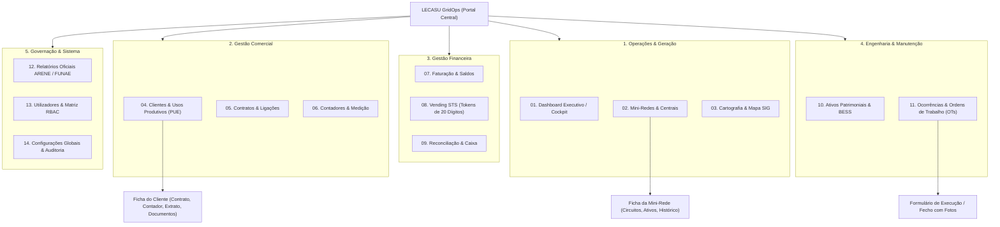

# 16 — Mapa de Navegação e Arquitetura de Informação
## LECASU GridOps — Plataforma Integrada de Gestão de Mini-Redes de Energia

**Documento:** Mapa Estrutural de Navegação, Menus e Fluxos de Ecrã  
**Projeto:** LECASU GridOps  
**Organização Promotora:** LECASU, Lda.  
**Referências Centrais:** PRD Consolidada (`docs/02-PRD-CONSOLIDADA.md`), Filosofia UX/UI (`docs/14-DOCUMENTO-UX-UI.md`) e Design System (`docs/15-DESIGN-SYSTEM.md`)  
**Responsável:** Arquitetura de Informação e Design de Interação  
**Data de Emissão:** 05 de Novembro de 2026  
**Estado:** Submetido para Validação e Aprovação Formal  

---

## 1. Visão Geral da Navegação

A arquitetura de navegação do **LECASU GridOps** foi desenhada para garantir acesso rápido e sem fricção a qualquer operação em no máximo 2 cliques a partir de qualquer ponto da plataforma.

A interface estrutura-se em três eixos principais:
1. **Barra Lateral de Navegação (*Sidebar*):** Menu principal persistente à esquerda, agrupado por domínios operacionais e retrátil para maximizar a área de trabalho em ecrãs menores.
2. **Barra Superior de Contexto e Controlo (*TopBar*):** Apresenta o caminho de navegação (*Breadcrumbs*), seletor global de mini-rede, relógio operacional oficial (UTC+2 de Moçambique), indicador de sincronização e perfil de utilizador.
3. **Área de Conteúdo (*Workspace*):** Espaço central dedicado à execução de tarefas, com scroll vertical suave e cabeçalho de ações rápidas.

---

## 2. Estrutura Detalhada dos Menus e Agrupamentos

### 2.1 Agrupamento 1: Operações & Monitorização
* **Dashboard Executivo:** Visão geral da produção solar instantânea (kW), energia acumulada (kWh), estado de carga do BESS (%), disponibilidade da rede e mapa operacional resumido.
* **Mini-Redes:** Inventário das centrais operadas pela LECASU, potências de pico, capacidade de baterias e estado operacional com navegação para a ficha detalhada.
* **Mapa SIG:** Visualização cartográfica em ecrã expandido com comutação de camadas (Centrais, Linhas de Baixa e Média Tensão, Postes, Caixas de Derivação e Clientes Georreferenciados).

### 2.2 Agrupamento 2: Gestão Comercial de Clientes
* **Clientes & Usos Produtivos (PUE):** Tabela de consumidores particulares e negócios locais (moageiras, frio comercial), filtros por tipo de uso e estado cadastral.
* **Contratos & Ligações:** Contratos de fornecimento celebrados, potência contratada (kVA), disjuntor de corte e tarifário associado.
* **Parque de Contadores:** Inventário de instrumentos de medição (STS pré-pago, eletromecânico, smart), números de série, rotas de leitura e alertas de anomalia de consumo.

### 2.3 Agrupamento 3: Gestão Financeira e Vending
* **Faturação & Saldos:** Emissão e liquidação de faturas pós-pagas, acompanhamento de saldos em conta corrente e monitorização de dívidas acumuladas.
* **Emissor de Tokens STS:** Módulo dedicado à venda rápida de eletricidade pré-paga com cálculo instantâneo de retenção de amortização de dívida e emissão do código de 20 dígitos.
* **Reconciliação & Caixa:** Fecho de caixa diário de agentes comunitários e importação de extratos das carteiras móveis (M-Pesa, e-Mola, mKesh) para conferência automática de saldos.

### 2.4 Agrupamento 4: Engenharia e O&M
* **Ativos Patrimoniais:** Catálogo de painéis solares, inversores fotovoltaicos, bancos de baterias (BESS) e transformadores com datas de garantia e histórico de intervenções.
* **Ordens de Trabalho (OTs):** Quadro operacional de tarefas de campo classificadas por SLA (Crítica 4h, Média 24h, Baixa 72h), despachos para técnicos, checklists técnicos e upload de evidências fotográficas.

### 2.5 Agrupamento 5: Governação e Sistema
* **Relatórios Regulatórios:** Módulo de geração de relatórios oficiais exigidos pelo regulador ARENE e pelo FUNAE em formato Excel e PDF pré-formatados.
* **Utilizadores & Permissões:** Gestão de operadores, associação aos 8 perfis RBAC homologados e atribuição de concessões geográficas.
* **Configurações Gerais:** Parametrização de tabelas tarifárias aprovadas, taxas de ligação, limites de caixa e trilha de auditoria imutável (*audit logs*).

---

## 3. Especificação dos Componentes Estruturais de Navegação

### 3.1 A Barra Lateral (*Sidebar*)
* **Largura Padrão:** 252px em modo expandido; 68px em modo recolhido (*collapsed*).
* **Comportamento Responsivo:**
  - Em monitores desktop, mantém-se fixa à esquerda com opção de recolhimento via botão de alternância (*toggle button*).
  - Em dispositivos móveis e tablets, recolhe automaticamente para um menu deslizante lateral (*Drawer*) acionado pelo botão hambúrguer no cabeçalho.
* **Elementos da Barra:**
  - Topo: Logótipo corporativo oficial da LECASU com indicador da versão da plataforma (`GridOps v1.0`).
  - Meio: Lista vertical de opções de menu com ícone nítido de 18px, texto de 14px em peso 500 e crachás numéricos (*badges*) indicando pendências ativas (ex: *3 OTs Críticas*).
  - Rodapé: Botão de alternância de recolhimento e versão do sistema.

### 3.2 O Cabeçalho (*TopBar*)
* **Altura Fixa:** 52px, fixado no topo com fundo branco puro e borda inferior de 1px em `#E2E8F0`.
* **Conteúdo Horizontal da Esquerda para a Direita:**
  1. Botão de alternância da barra lateral.
  2. Trilho de Navegação (*Breadcrumbs*) contextual (ex: `Operações / Mini-Redes / Central de Mavume / Ficha Técnica`).
  3. Seletor Global de Concessão: Caixa de seleção que permite filtrar instantaneamente todos os dados do sistema por uma mini-rede específica ou visualizar a operação consolidada.
  4. Relógio Digital Operacional: Exibição contínua da hora oficial de Moçambique (`UTC+2`) com carimbo de atualização ao vivo.
  5. Indicador de Conectividade e Sincronização: Ícone com tooltip e badge que reflete o estado do Service Worker (Verde: Sincronizado; Amarelo: X pendentes offline; Azul: A sincronizar).
  6. Sineta de Notificações com contador de alertas não lidos.
  7. Painel de Utilizador: Nome do operador, badge com sigla do perfil (ex: `OP_MGR`, `TECH`, `FIN`) e menu suspenso com opções de perfil e encerramento de sessão (*Logout*).

---

## 4. Navegação Móvel em Dispositivos de Campo (PWA)

Para os técnicos e agentes no terreno, a navegação adapta-se ergonomicamente para uso com apenas uma mão:
* **Barra de Navegação Inferior (*Bottom Navigation Bar*):** Fixada no rodapé do ecrã com os 4 destinos mais frequentes em campo:
  1. *Tarefas do Dia (OTs)*
  2. *Leituras de Contador*
  3. *Venda STS (Tokens)*
  4. *Clientes / Mapa*
* **Ações Primárias em Botão Flutuante (*Floating Action Button - FAB*):** No canto inferior direito para acesso instantâneo à leitura por câmara ou abertura rápida de ocorrência de emergência.

